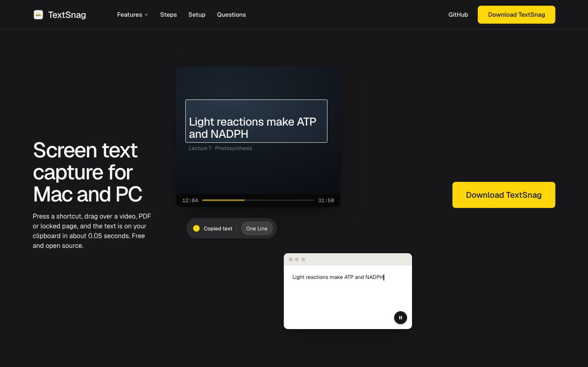

<p align="center">
  
</p>

<h1 align="center">TextSnag</h1>

<p align="center">
  <b>Copy text from anything on your screen.</b><br>
  Press a shortcut, drag over a video, PDF, image or locked web page, and the text is on your clipboard.<br>
  Free, open source, and it never leaves your computer. For macOS and Windows.
</p>

<p align="center">
  <a href="https://github.com/ankushachwani/TextSnag/releases/latest/download/TextSnag.zip"><b>Download for Mac</b></a>
  &nbsp;·&nbsp;
  <a href="https://github.com/ankushachwani/TextSnag/releases/latest/download/TextSnag-Windows.zip"><b>Download for Windows</b></a>
  &nbsp;·&nbsp;
  <a href="https://ankushachwani.github.io/TextSnag/">Website</a>
</p>

<p align="center">
  <a href="https://github.com/ankushachwani/TextSnag/releases/latest"></a>
  
  
  <a href="LICENSE"></a>
  <a href="https://github.com/ankushachwani/TextSnag/actions/workflows/macos.yml"></a>
  <a href="https://github.com/ankushachwani/TextSnag/actions/workflows/windows.yml"></a>
</p>

<p align="center">
  
</p>

## Why TextSnag

| | |
| --- | --- |
| **Exact text, not a guess** | In a dialog, a settings page or a web page that blocks copying, TextSnag copies the app's own characters (macOS Accessibility, Windows UI Automation), but only when they match what's visible, so hidden text never sneaks in. Images, PDFs and video use OCR. |
| **Code stays runnable** | Indentation is kept, curly quotes and full-width characters become normal ones, and light-on-dark terminals are read too. |
| **Tables paste as tables** | Real cells in Excel, Numbers, Word or Google Sheets, and a neat text table (valid Markdown) in chat apps. |
| **Quick actions** | The "Copied" bubble offers what fits: One Line, Numbers, Not a Table, Open Link, Email, Call, or Original. It closes after 3 seconds or as soon as you paste. |
| **QR codes and barcodes** | Read in the same drag, optionally opening their links. |
| **Private by design** | Recognition runs on Apple Vision or Windows OCR, on your computer. No account, no uploads, no network calls. |

Also: custom shortcuts (Start Capture, Capture Without Line Breaks, Capture Previous Area, Toggle
Additive Clipboard), an additive clipboard that appends each capture, read-aloud, and every
formatting step optional (line breaks, indentation, bullets, punctuation spacing, straight quotes).

## Install

### macOS 13 or later (Apple Silicon and Intel)

1. [Download TextSnag.zip](https://github.com/ankushachwani/TextSnag/releases/latest/download/TextSnag.zip), unzip it and drag **TextSnag** to Applications.
2. Open it. If macOS says it can't check the app, open **System Settings → Privacy & Security** and click **Open Anyway** (the build is signed but not yet notarized).
3. Turn on TextSnag under **Screen Recording** when asked, then reopen it.
4. Press **⌥⌘5** and drag over some text.

Optional, for exact text: Settings → Formatting → **Allow…**, then turn on TextSnag under Privacy & Security → Accessibility.

### Windows 10 (1903+) or 11 (x64 and ARM64)

1. [Download TextSnag-Windows.zip](https://github.com/ankushachwani/TextSnag/releases/latest/download/TextSnag-Windows.zip) and unzip it anywhere, for example `%LOCALAPPDATA%\Programs\TextSnag`.
2. Run **TextSnag.exe**. If SmartScreen appears, click **More info → Run anyway**.
3. Press **Ctrl+Alt+5** (or left-click the tray icon) and drag over some text. Windows 11 tucks new tray icons into the **^** overflow; drag it onto the taskbar to keep it in view.

No permissions are needed. Windows OCR reads the languages that have text recognition installed (normally your display language); add more under Settings → Time & language → Language & region.

## Build from source

The two apps live side by side and share only the icon and the formatting rules.

```
macos/     Swift (AppKit + Vision)          macos/scripts/build-app.sh
windows/   C# (WinForms + Windows OCR)      windows/build.ps1
site/      the website (GitHub Pages)
scripts/   make-icon.swift: draws the icon for both platforms
```

**macOS** (Xcode or the Command Line Tools):

```sh
macos/scripts/build-app.sh            # builds and signs dist/TextSnag.app
macos/scripts/build-app.sh --install  # also installs to /Applications and launches it
macos/scripts/build-app.sh --zip      # also makes dist/TextSnag.zip
cd macos && swift build -c release && .build/release/TextSnag --selftest
```

Signing uses the first "Developer ID Application" certificate in your keychain, else an ad-hoc
signature. To notarize, create a notarytool profile and run `NOTARY_PROFILE=<profile> macos/scripts/build-app.sh --zip`.

**Windows** ([.NET SDK](https://dotnet.microsoft.com/download) 8 or later; it cross-compiles from macOS or Linux too):

```powershell
windows\build.ps1             # builds and makes dist\TextSnag-Windows.zip
windows\build.ps1 -Install    # also installs to %LOCALAPPDATA%\Programs\TextSnag and launches it
dotnet run --project windows/Tests                     # formatting rules, any OS
& windows/TextSnag/bin/Release/net48/TextSnag.exe --selftest | Out-Host
```

GitHub Actions builds each app when its folder changes and deploys the website from `site/`.

## How it works

<details>
<summary><b>macOS</b> (<code>macos/Sources/TextSnag</code>)</summary>

| File | What it does |
| --- | --- |
| `AppDelegate.swift` | Menu bar menu, capture flow, clipboard, speech |
| `ScreenCapture.swift` | Runs macOS's `screencapture` for the selection UI |
| `OCR.swift` | Vision text and barcode recognition, code re-reads, warm-up |
| `TextFormatter.swift` | Code and table detection, formatting options, quick-action transforms |
| `DirectText.swift` | Reads an app's own text via the Accessibility API and checks it against OCR |
| `HotKey.swift` | Global shortcuts (Carbon `RegisterEventHotKey`, no Accessibility permission needed) |
| `Settings.swift`, `SettingsWindow.swift` | Preferences and the shortcut recorder |
| `Toast.swift` | The "Copied" bubble and its quick-action buttons |

About **0.05 s** from releasing the mouse to text on the clipboard (Apple Silicon): the grab is
uncompressed TIFF in a private temp file, QR detection runs in parallel, and the recognizer is
warmed up at launch.
</details>

<details>
<summary><b>Windows</b> (<code>windows/</code>)</summary>

A C# WinForms app on .NET Framework 4.8, which ships with Windows 10 and 11, so there's nothing
extra to install. `windows/Core` is a line-for-line port of `TextFormatter.swift`: change one, change the other.

| File | What it does |
| --- | --- |
| `TextSnag/TrayApp.cs` | Notification-area icon and menu, capture flow, quick actions, speech |
| `TextSnag/ScreenCapture.cs` | Freezes the screen and shows the drag-to-select overlay on every monitor |
| `TextSnag/Ocr.cs` | Windows OCR (`Windows.Media.Ocr`), QR codes (ZXing.Net), bullets, table cells, dark images |
| `Core/TextFormatter.cs` | Code and table detection, formatting options, quick-action transforms |
| `Core/DataDetector.cs` | Links, email addresses and phone numbers for quick actions |
| `TextSnag/DirectText.cs` | Reads an app's own text via UI Automation and checks it against OCR |
| `TextSnag/ClipboardService.cs` | Clipboard writes; delayed rendering tells TextSnag when you paste |
| `TextSnag/HotKeys.cs` | Global shortcuts (`RegisterHotKey`, no keyboard hook) |
| `TextSnag/Settings.cs`, `SettingsForm.cs` | Preferences (`HKCU\Software\TextSnag`) and the shortcut recorder |
| `TextSnag/Toast.cs` | The "Copied" bubble and its quick-action buttons |
| `Tests/Program.cs` | Cross-platform tests for the formatting core |
</details>

## License

MIT. The website uses parts of [taste-skill](https://github.com/Leonxlnx/taste-skill) (MIT); its licence is in `site/assets/LICENSE-taste-skill`.
